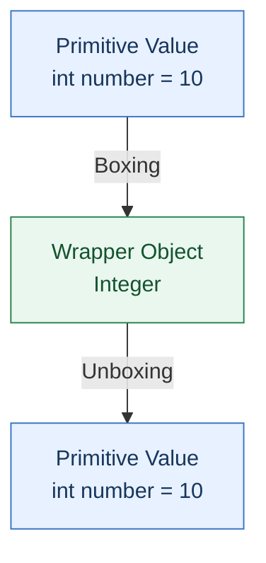
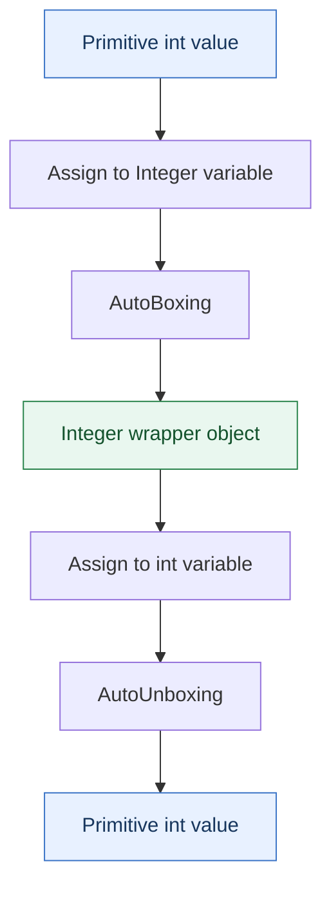
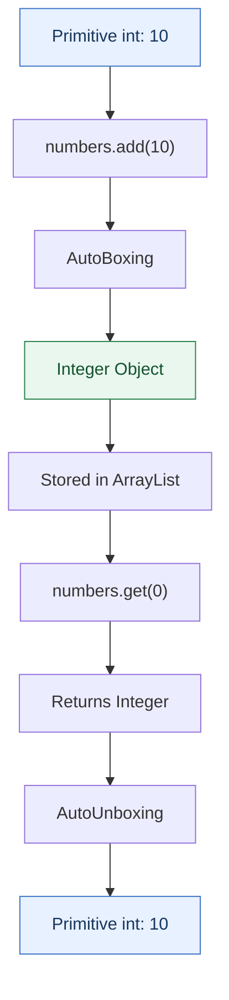
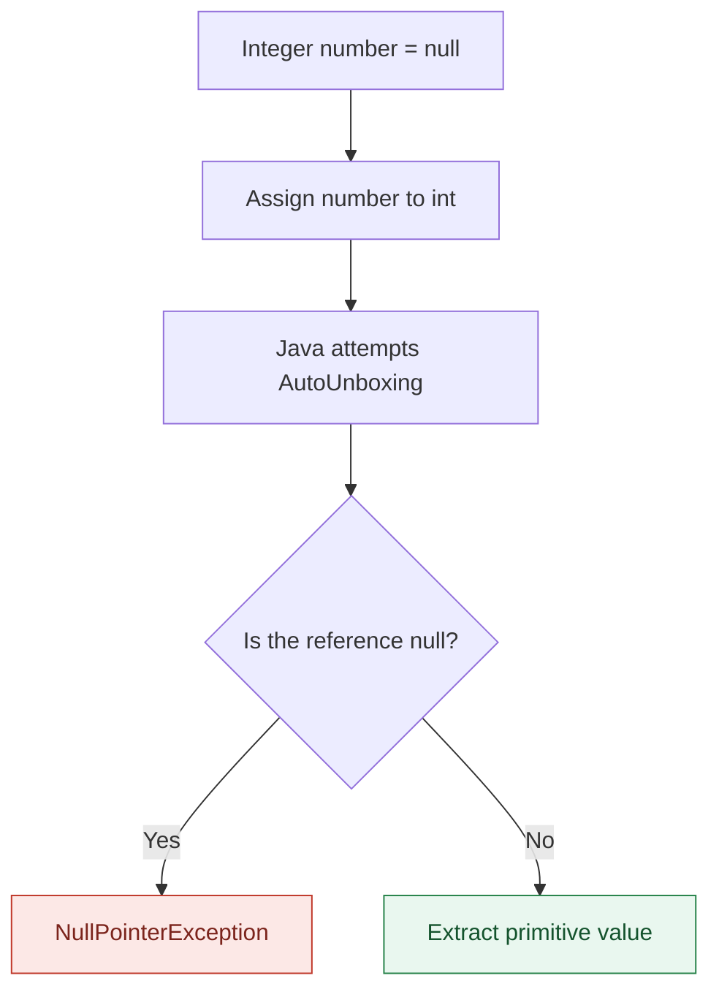
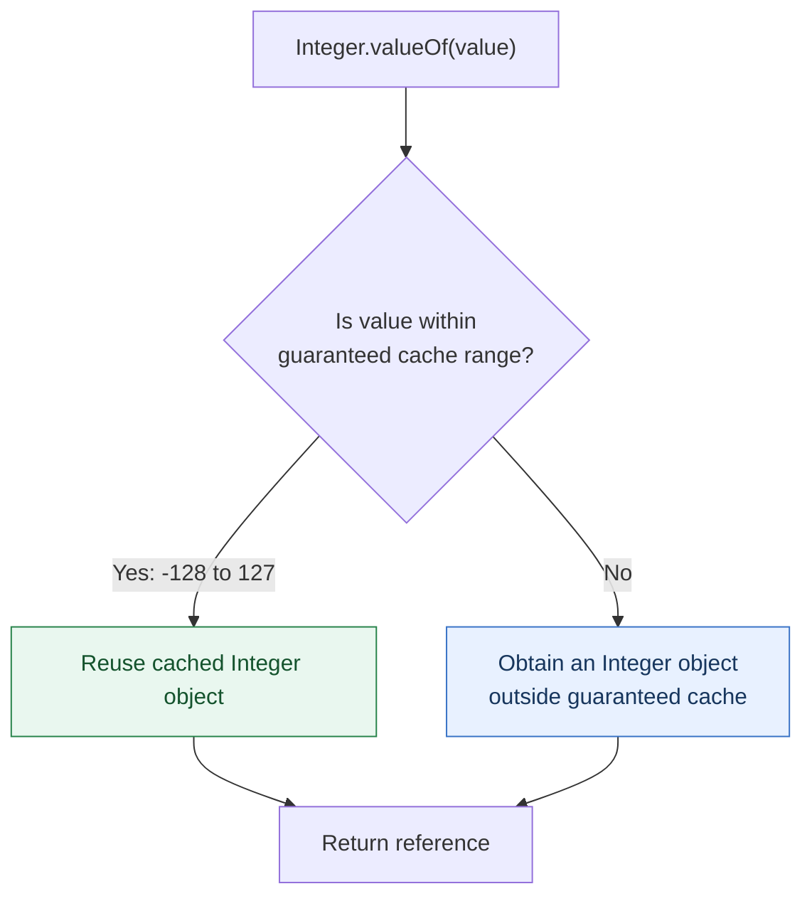
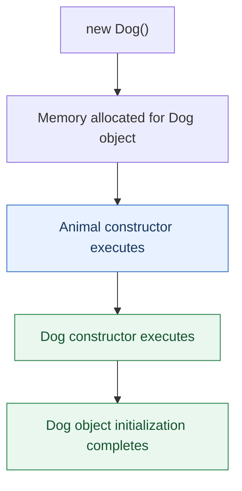
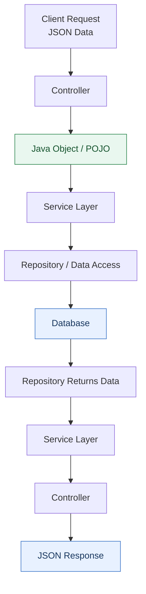
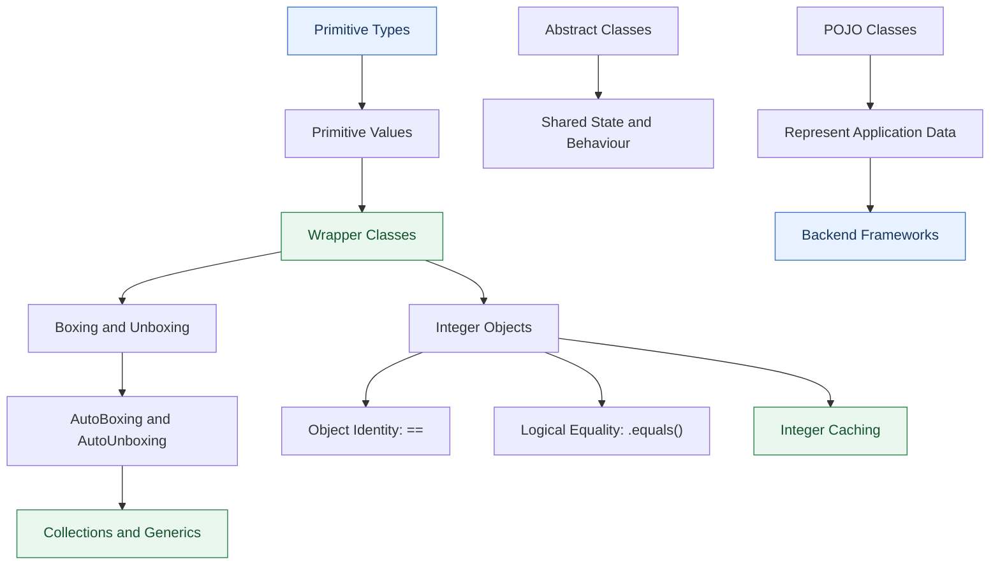

# L11 — AutoBoxing and POJOs

## Why am I learning this?

Until now, I've mostly worked with primitive types, objects, classes, inheritance, and other OOP concepts.

But Java has a few things happening behind the scenes that are important to understand.

For example:

- Why can I store an `int` inside an `ArrayList<Integer>`?
- What exactly happens when Java converts an `int` into an `Integer`?
- Why can comparing two `Integer` objects with `==` sometimes give `true` and sometimes `false`?
- Why does unboxing a `null` value throw a `NullPointerException`?
- What is a POJO, and why do backend frameworks use these classes so much?

I don't want to just memorize these behaviours. I want to understand what Java is doing with values, references, and objects.

That's what this lesson is about.

---

# Part 1 — Understanding Primitive and Reference Types

## 1. Primitive Types vs Reference Types

Before understanding Wrapper Classes, I need to be completely clear about the difference between primitive and reference types.

Java has 8 primitive types:

| Primitive Type | Example |
|---|---|
| `byte` | `byte age = 20;` |
| `short` | `short number = 100;` |
| `int` | `int marks = 90;` |
| `long` | `long population = 100000L;` |
| `float` | `float price = 10.5f;` |
| `double` | `double salary = 45000.50;` |
| `char` | `char grade = 'A';` |
| `boolean` | `boolean isPassed = true;` |

These types store simple values.

Reference types include:

- Classes
- Objects
- Arrays
- Interfaces
- Strings
- Enums

The important difference is what the variable represents.

### Primitive variables

A primitive variable holds its actual value.

```java
int a = 10;
int b = a;

b = 20;

System.out.println(a);
System.out.println(b);
```

Output:

```text
10
20
```

When I write `int b = a`, Java copies the value of `a` into `b`.

Both variables have their own independent values.

### Memory perspective

```text
              STACK
       ┌───────────────────┐
       │ Variable: a       │
       │ Value: 10         │
       ├───────────────────┤
       │ Variable: b       │
       │ Value: 20         │
       └───────────────────┘

       Two independent values
```

Changing `b` does not change `a`.

### Reference variables

Now consider an object.

```java
class Student {
    String name;
}

public class Main {
    public static void main(String[] args) {

        Student s1 = new Student();
        s1.name = "Vivek";

        Student s2 = s1;

        s2.name = "Rahul";

        System.out.println(s1.name);
        System.out.println(s2.name);
    }
}
```

Output:

```text
Rahul
Rahul
```

Why did changing `s2.name` also affect what I see through `s1`?

Because `s1` and `s2` refer to the same object.

When I write:

```java
Student s2 = s1;
```

Java copies the reference, not the entire object.

### Memory perspective

```text
                 STACK                         HEAP
       ┌────────────────────┐
       │ s1                 │
       │ Reference ─────────┼──────────────┐
       ├────────────────────┤              │
       │ s2                 │              │
       │ Reference ─────────┼──────────┐   │
       └────────────────────┘          │   │
                                       ▼   ▼
                                  ┌──────────────┐
                                  │ Student      │
                                  ├──────────────┤
                                  │ name         │
                                  │ "Rahul"      │
                                  └──────────────┘

                         Both references point
                         to the same object.
```

This is one of the most important things to remember in Java.

| Primitive Type | Reference Type |
|---|---|
| Holds a primitive value | Holds a reference to an object |
| Assignment copies the value | Assignment copies the reference |
| Cannot be `null` | Can be `null` |
| Has a fixed set of 8 types | Includes classes, arrays, interfaces, etc. |

**My takeaway:** Primitive assignment copies a value. Reference assignment copies a reference. It does not automatically create another object.

---

# Part 2 — Wrapper Classes

## 2. Why Do Wrapper Classes Exist?

Now imagine I want to store integers inside an `ArrayList`.

I might naturally try:

```java
ArrayList<int> numbers = new ArrayList<>();
```

But Java doesn't allow this.

Why?

Because Java Generics work with reference types, not primitive types.

For example:

```java
ArrayList<Integer> numbers = new ArrayList<>();
```

This works.

But why `Integer` instead of `int`?

Java provides something called **Wrapper Classes**.

They allow primitive values to be represented as objects.

Think of a wrapper class as a class that provides an object representation of a primitive value.

### Why are they useful?

Wrapper Classes are useful when:

1. Working with Collections such as `ArrayList`, `HashMap`, and `HashSet`.
2. Using Java Generics.
3. Representing a value that may be absent using `null`.
4. Calling useful methods provided by wrapper classes.
5. Working with APIs that expect objects instead of primitive values.

For example:

```java
ArrayList<Integer> marks = new ArrayList<>();

marks.add(90);
marks.add(85);
marks.add(95);
```

Here, `ArrayList` stores `Integer` objects rather than primitive `int` values.

---

## 3. Wrapper Classes in Java

Java provides 8 wrapper classes for its 8 primitive types.

| Primitive Type | Wrapper Class |
|---|---|
| `byte` | `Byte` |
| `short` | `Short` |
| `int` | `Integer` |
| `long` | `Long` |
| `float` | `Float` |
| `double` | `Double` |
| `char` | `Character` |
| `boolean` | `Boolean` |

A few important examples:

```java
int number = 10;

Integer wrappedNumber = Integer.valueOf(number);

double price = 99.5;

Double wrappedPrice = Double.valueOf(price);

char grade = 'A';

Character wrappedGrade = Character.valueOf(grade);
```

Here:

- `int` is the primitive type.
- `Integer` is the wrapper class.
- `Integer.valueOf()` creates or returns an `Integer` object representing the value.

Wrapper objects are immutable.

That means once a wrapper object is created, its value cannot be changed.

For example:

```java
Integer number = 10;

number = 20;
```

It may look like the existing object's value changed, but that's not what happens.

The variable is reassigned to another `Integer` value. The original object, if no longer referenced, becomes eligible for garbage collection.

**My takeaway:** Wrapper classes give primitive values an object representation. They are especially important when working with Generics and Collections.

---

# Part 3 — Boxing and Unboxing

## 4. Boxing and Unboxing

Now that I understand wrapper classes, I need to understand how primitive values and wrapper objects are converted.

There are two terms:

- Boxing
- Unboxing

### Boxing

Converting a primitive value into its corresponding wrapper object is called **Boxing**.

```java
int number = 10;

Integer wrappedNumber = Integer.valueOf(number);
```

The primitive value `10` is represented by an `Integer` object.

### Unboxing

Converting a wrapper object into its corresponding primitive value is called **Unboxing**.

```java
Integer wrappedNumber = Integer.valueOf(10);

int number = wrappedNumber.intValue();
```

Here, the `Integer` object is converted back into an `int`.

### Visual understanding



**My takeaway:**

- Boxing: Primitive → Wrapper Object
- Unboxing: Wrapper Object → Primitive

---

## 5. AutoBoxing and AutoUnboxing

Writing `Integer.valueOf()` and `intValue()` every time can become repetitive.

Java makes this easier through **AutoBoxing** and **AutoUnboxing**.

### AutoBoxing

When Java automatically converts a primitive into its corresponding wrapper object, it is called AutoBoxing.

```java
int number = 10;

Integer wrappedNumber = number;
```

I didn't explicitly call `Integer.valueOf()`.

Java handles the conversion automatically.

Conceptually, the compiler performs a conversion equivalent to:

```java
Integer wrappedNumber = Integer.valueOf(number);
```

### AutoUnboxing

When Java automatically converts a wrapper object into its primitive value, it is called AutoUnboxing.

```java
Integer wrappedNumber = 20;

int number = wrappedNumber;
```

Conceptually, Java performs something equivalent to:

```java
int number = wrappedNumber.intValue();
```

### Visual execution flow



---

## 6. Where Does Java Automatically Box and Unbox?

AutoBoxing and AutoUnboxing aren't limited to variable assignments.

Java can perform these conversions in different situations.

### 1. During assignment

```java
int a = 10;

Integer b = a; // AutoBoxing

int c = b;     // AutoUnboxing
```

### 2. While passing method arguments

```java
public class Main {

    static void display(Integer number) {
        System.out.println(number);
    }

    public static void main(String[] args) {

        int value = 50;

        display(value);
    }
}
```

The method expects an `Integer`, but I pass an `int`.

Java automatically boxes the value.

### 3. While returning values

```java
public class Main {

    static Integer getNumber() {
        int number = 100;

        return number;
    }

    public static void main(String[] args) {

        Integer result = getNumber();

        System.out.println(result);
    }
}
```

The method returns an `Integer`, but the local variable is an `int`.

Java automatically boxes the returned value.

### 4. During arithmetic operations

```java
Integer a = 10;
Integer b = 20;

int result = a + b;

System.out.println(result);
```

Output:

```text
30
```

Java unboxes both `Integer` objects before performing primitive integer addition.

Conceptually:

```java
int result = a.intValue() + b.intValue();
```

**My takeaway:** Java can automatically box and unbox values in assignments, method calls, return statements, and operations where the conversion is required.

---

# Part 4 — AutoBoxing with Collections and Generics

## 7. AutoBoxing with Collections and Generics

This is one of the most practical places where AutoBoxing is used.

Consider:

```java
ArrayList<Integer> numbers = new ArrayList<>();

numbers.add(10);
numbers.add(20);
numbers.add(30);
```

The `add()` method expects an `Integer` object.

But I am passing primitive `int` values.

Why does this work?

Because Java automatically boxes them.

Conceptually:

```java
numbers.add(Integer.valueOf(10));
numbers.add(Integer.valueOf(20));
numbers.add(Integer.valueOf(30));
```

Now consider retrieving a value:

```java
int number = numbers.get(0);
```

`get()` returns an `Integer`, but I am assigning it to an `int`.

Java automatically unboxes it.

### Complete execution flow



### Memory perspective

```text
                  STACK                         HEAP
        ┌─────────────────────┐
        │ numbers             │
        │ Reference ──────────┼──────────────┐
        └─────────────────────┘              │
                                             ▼
                                    ┌──────────────────┐
                                    │ ArrayList        │
                                    ├──────────────────┤
                                    │ Element 0 ───────┼─────┐
                                    │ Element 1 ───────┼──┐  │
                                    │ Element 2 ───────┼┐ │  │
                                    └──────────────────┘│ │  │
                                                        │ │  │
                                      ┌─────────────────┘ │  │
                                      ▼                   ▼  ▼
                                 ┌─────────┐         ┌─────────┐
                                 │ Integer │         │ Integer │
                                 │  30     │         │  20     │
                                 └─────────┘         └─────────┘

                                           ┌─────────┐
                                           │ Integer │
                                           │  10     │
                                           └─────────┘
```

The diagram is a conceptual representation of the references and objects involved. Actual internal storage of collection elements is implementation-dependent.

### Why can't I use primitives directly in Generics?

This is invalid:

```java
ArrayList<int> numbers = new ArrayList<>();
```

This is valid:

```java
ArrayList<Integer> numbers = new ArrayList<>();
```

Java Generics require reference types as type arguments. Wrapper classes make it possible to use primitive-like values with generic APIs.

**My takeaway:** Collections and Generics use reference types. AutoBoxing and AutoUnboxing make working with primitive values convenient.

---

# Part 5 — Important Problems with Unboxing

## 8. NullPointerException During Unboxing

This is something I need to be careful about.

A wrapper reference can contain `null`.

A primitive variable cannot.

Consider:

```java
Integer number = null;

int value = number;

System.out.println(value);
```

This code compiles, but it throws:

```text
NullPointerException
```

Why?

Because Java tries to unbox `number`.

Conceptually:

```java
int value = number.intValue();
```

But `number` is `null`.

Java cannot call `intValue()` on a null reference.

### Execution flow



### A safer approach

```java
Integer number = null;

int value = (number != null) ? number : 0;

System.out.println(value);
```

Output:

```text
0
```

I check whether the reference is `null` before unboxing it.

**My takeaway:** AutoUnboxing a null wrapper reference causes a `NullPointerException`. Always check nullable wrapper values before using them as primitives.

---

# Part 6 — Understanding Integer Objects

## 9. `==` vs `.equals()`

This is one of the most confusing parts of Wrapper Classes.

I need to understand the difference between comparing primitive values and comparing objects.

### Comparing primitive values

```java
int a = 100;
int b = 100;

System.out.println(a == b);
```

Output:

```text
true
```

For primitives, `==` compares the actual values.

### Comparing wrapper objects

```java
Integer a = new Integer(100);
Integer b = new Integer(100);

System.out.println(a == b);
System.out.println(a.equals(b));
```

Conceptually, the output is:

```text
false
true
```

Note: The `Integer(int)` constructor is deprecated for removal. It is shown here only to illustrate the idea of two distinct objects. Do not use it in normal code.

Why are the results different?

Because `==` and `.equals()` do different things when used with reference types.

### `==` with objects

For reference types, `==` checks whether both references point to the same object.

It checks **object identity**.

### `.equals()` with objects

`.equals()` checks logical equality according to the implementation of that class.

The `Integer` class overrides `.equals()` to compare the integer values.

### Memory perspective

```text
                    STACK                         HEAP
          ┌────────────────────┐
          │ a                  │
          │ Reference ─────────┼───────────────┐
          ├────────────────────┤               │
          │ b                  │               │
          │ Reference ─────────┼───────────┐   │
          └────────────────────┘           │   │
                                           ▼   ▼
                                      ┌────────────┐
                                      │ Integer A  │
                                      ├────────────┤
                                      │ value: 100 │
                                      └────────────┘

                                      ┌────────────┐
                                      │ Integer B  │
                                      ├────────────┤
                                      │ value: 100 │
                                      └────────────┘

                    Two different objects
                    containing equal values.
```

So:

```java
a == b       // false
a.equals(b)  // true
```

### Quick comparison

| Comparison | What it checks |
|---|---|
| `intA == intB` | Primitive values |
| `integerA == integerB` | Object identity |
| `integerA.equals(integerB)` | Integer values |

One more useful method:

```java
Objects.equals(a, b);
```

It performs a null-safe equality check.

For example:

```java
Integer a = null;
Integer b = 100;

System.out.println(Objects.equals(a, b));
```

Output:

```text
false
```

**My takeaway:** For primitives, `==` compares values. For references, `==` compares identity. For `Integer`, `.equals()` compares the numerical values.

---

## 10. How Does Integer Work?

`Integer` is a wrapper class for the primitive `int`.

It provides useful methods for working with integer values.

For example:

```java
public class Main {

    public static void main(String[] args) {

        Integer number = 100;

        System.out.println(number.intValue());

        System.out.println(Integer.MAX_VALUE);

        System.out.println(Integer.MIN_VALUE);

        System.out.println(Integer.parseInt("500"));

        System.out.println(Integer.toString(200));
    }
}
```

Output:

```text
100
2147483647
-2147483648
500
200
```

Some useful methods and fields:

| Method / Field | Purpose |
|---|---|
| `intValue()` | Converts Integer into primitive int |
| `Integer.valueOf()` | Returns an Integer object |
| `Integer.parseInt()` | Converts a String into primitive int |
| `Integer.toString()` | Converts an int into a String |
| `Integer.MAX_VALUE` | Maximum int value |
| `Integer.MIN_VALUE` | Minimum int value |

### Important point: Integer is immutable

Consider:

```java
Integer number = 100;

number = number + 50;

System.out.println(number);
```

Output:

```text
150
```

It might look like Java modified the existing `Integer` object.

But wrapper objects are immutable.

Conceptually, the process is:

1. Unbox `number` into an `int`.
2. Add `50`.
3. Box the result into an `Integer`.
4. Reassign the variable to the resulting reference.

The original object is not modified.

---

## 11. Integer Caching

This is where things get interesting.

Consider:

```java
Integer a = 100;
Integer b = 100;

System.out.println(a == b);
```

Output:

```text
true
```

But now:

```java
Integer a = 1000;
Integer b = 1000;

System.out.println(a == b);
```

On a typical JVM with the default Integer cache, output:

```text
false
```

Why?

Because Java uses something called **Integer Caching**.

### What is Integer Caching?

Java maintains a cache of commonly used Integer values.

The Integer values from:

```text
-128 to 127
```

are guaranteed to be cached by the standard boxing conversion behaviour and `Integer.valueOf()`.

When I write:

```java
Integer a = 100;
Integer b = 100;
```

Java can reuse the same cached object.

Therefore, both references can point to the same object.

### Memory perspective: Cached value

```text
                    STACK                         HEAP
          ┌────────────────────┐
          │ a                  │
          │ Reference ─────────┼──────────────┐
          ├────────────────────┤              │
          │ b                  │              │
          │ Reference ─────────┼──────────┐   │
          └────────────────────┘          │   │
                                          ▼   ▼
                                    ┌──────────────┐
                                    │ Cached       │
                                    │ Integer      │
                                    ├──────────────┤
                                    │ value: 100   │
                                    └──────────────┘

                            One shared object
```

Therefore:

```java
a == b       // true
a.equals(b)  // true
```

### What happens outside the guaranteed cache range?

Consider:

```java
Integer a = 1000;
Integer b = 1000;

System.out.println(a == b);
System.out.println(a.equals(b));
```

With the usual default cache:

```text
false
true
```

The references normally point to separate objects, even though the values are equal.

### Memory perspective: Separate objects

```text
                    STACK                         HEAP
          ┌────────────────────┐
          │ a                  │
          │ Reference ─────────┼───────────────┐
          ├────────────────────┤               │
          │ b                  │               │
          │ Reference ─────────┼───────────┐   │
          └────────────────────┘           │   │
                                           ▼   ▼
                                      ┌────────────┐
                                      │ Integer A  │
                                      ├────────────┤
                                      │ value:1000 │
                                      └────────────┘

                                      ┌────────────┐
                                      │ Integer B  │
                                      ├────────────┤
                                      │ value:1000 │
                                      └────────────┘

                          Separate objects,
                          equal numerical values.
```

### Integer caching flow



A JVM may cache additional values beyond the guaranteed range. Therefore, I should never depend on `==` to compare Integer values.

### The correct habit

Use:

```java
a.equals(b);
```

Or, if either reference might be null:

```java
Objects.equals(a, b);
```

**My takeaway:** Integer caching is an optimization. It explains why `==` may behave differently for different values. I should use `.equals()` when comparing Integer values.

---

# Part 7 — Revising Abstract Classes

## 12. Abstract Class Revision and Interview Questions

Before moving to POJOs, I want to revise Abstract Classes because they are important in OOP and interviews.

An abstract class is a class declared using the `abstract` keyword.

It cannot be instantiated directly.

```java
abstract class Animal {

    abstract void sound();

    void eat() {
        System.out.println("Animal is eating");
    }
}
```

Here:

- `Animal` is an abstract class.
- `sound()` is an abstract method.
- `eat()` is a concrete method.

An abstract method has no method body.

A concrete method has a method body.

### Why do we need abstract classes?

Imagine I have different types of animals.

Every animal should have a `sound()` method, but each animal makes a different sound.

I can define a common structure in an abstract class and let child classes provide their own implementations.

```java
abstract class Animal {

    abstract void sound();

    void eat() {
        System.out.println("Eating...");
    }
}

class Dog extends Animal {

    @Override
    void sound() {
        System.out.println("Dog barks");
    }
}

class Cat extends Animal {

    @Override
    void sound() {
        System.out.println("Cat meows");
    }
}
```

Now:

```java
public class Main {

    public static void main(String[] args) {

        Animal animal = new Dog();

        animal.sound();
        animal.eat();
    }
}
```

Output:

```text
Dog barks
Eating...
```

### Abstract class constructor execution

An abstract class cannot be instantiated directly, but it can have a constructor.

When I create a child object, the parent constructor executes first.

```java
abstract class Animal {

    Animal() {
        System.out.println("Animal constructor");
    }
}

class Dog extends Animal {

    Dog() {
        System.out.println("Dog constructor");
    }
}

public class Main {

    public static void main(String[] args) {

        Dog dog = new Dog();
    }
}
```

Output:

```text
Animal constructor
Dog constructor
```

### Constructor execution flow



### Important rules of Abstract Classes

1. An abstract class cannot be instantiated directly.
2. An abstract class can have constructors.
3. It can contain instance variables.
4. It can contain both abstract and concrete methods.
5. A concrete child class must implement all inherited abstract methods.
6. An abstract class can extend another class.
7. An abstract class cannot be declared `final`.
8. An abstract class does not necessarily need to contain an abstract method.
9. An abstract method cannot be `private`, `static`, or `final`.

### Abstract Class vs Interface

This is an important comparison because both are used to define common behaviour and contracts.

| Abstract Class | Interface |
|---|---|
| Declared using `abstract class` | Declared using `interface` |
| Can have constructors | Cannot have constructors |
| Can have instance variables | Cannot have ordinary instance variables |
| Can have abstract and concrete methods | Can have abstract, default, static and private methods |
| Can maintain object state | Fields are implicitly `public static final` constants |
| A class can extend only one class | A class can implement multiple interfaces |
| Useful for closely related classes sharing state and implementation | Useful for defining capabilities and contracts |

### Can I use both together?

Yes.

```java
abstract class Vehicle {

    abstract void start();

    void stop() {
        System.out.println("Vehicle stopped");
    }
}

interface GPS {

    void navigate();
}

class Car extends Vehicle implements GPS {

    @Override
    void start() {
        System.out.println("Car started");
    }

    @Override
    public void navigate() {
        System.out.println("Navigation started");
    }
}
```

A class can extend an abstract class and implement multiple interfaces.

### Interview questions to revise

**Q1. Can we create an object of an abstract class?**

No. An abstract class cannot be instantiated directly. However, we can create a reference of its type that points to a child object.

**Q2. Can an abstract class have a constructor?**

Yes. Its constructor executes when a child-class object is created.

**Q3. Can an abstract class have no abstract methods?**

Yes. A class can be declared abstract even if it contains only concrete methods.

**Q4. Can an abstract class extend another abstract class?**

Yes. An abstract class can extend another abstract class.

**Q5. What happens if a child class does not implement all abstract methods?**

The child class must also be declared abstract. Otherwise, it produces a compilation error.

**My takeaway:** An abstract class provides a shared base with common state and behaviour, while allowing child classes to provide their own implementations.

---

# Part 8 — POJO Classes

## 13. What Are POJO Classes?

POJO stands for **Plain Old Java Object**.

The name sounds complicated, but the idea is simple.

A POJO is an ordinary Java class that is not forced to extend a particular framework class or implement a framework-specific interface just to represent an object.

For example:

```java
public class Student {

    private int id;
    private String name;
    private int age;

    public Student() {
    }

    public Student(int id, String name, int age) {
        this.id = id;
        this.name = name;
        this.age = age;
    }

    public int getId() {
        return id;
    }

    public void setId(int id) {
        this.id = id;
    }

    public String getName() {
        return name;
    }

    public void setName(String name) {
        this.name = name;
    }

    public int getAge() {
        return age;
    }

    public void setAge(int age) {
        this.age = age;
    }
}
```

This is a typical POJO.

It contains:

- Fields to represent data.
- Constructors to create objects.
- Getters and setters to access or update fields.
- No mandatory dependency on a particular framework.

A POJO does not strictly have to contain getters and setters. The main idea is that it is an ordinary Java object without unnecessary framework-specific restrictions.

### Creating a POJO object

```java
public class Main {

    public static void main(String[] args) {

        Student student = new Student(
            101,
            "Vivek",
            20
        );

        System.out.println(student.getName());
    }
}
```

Output:

```text
Vivek
```

### Memory perspective

```text
                     STACK                         HEAP
          ┌─────────────────────┐
          │ student             │
          │ Reference ──────────┼───────────────┐
          └─────────────────────┘               │
                                                ▼
                                     ┌──────────────────────┐
                                     │ Student Object       │
                                     ├──────────────────────┤
                                     │ id   = 101           │
                                     │ name = "Vivek"       │
                                     │ age  = 20            │
                                     └──────────────────────┘
```

The `student` variable holds a reference to the Student object.

The object's fields represent its state.

**My takeaway:** A POJO is simply a normal Java object used to represent data and, when needed, related behaviour.

---

## 14. Why Are POJOs Useful in Frameworks?

This is where POJOs become especially important for backend development.

When building backend applications, I frequently work with data such as:

- Users
- Products
- Orders
- Payments
- Students
- Employees

I need Java classes to represent these entities.

For example, in a backend application, I might have:

```java
public class User {

    private String name;
    private String email;
    private String password;
}
```

This class represents a User in my application.

Frameworks can work with these ordinary Java objects.

### How frameworks use POJOs

Different frameworks use Java objects in different ways.

**1. Spring Framework**

Spring can create and manage ordinary Java objects as Spring beans.

These objects can be injected into other classes using Dependency Injection.

**2. Hibernate**

Hibernate can map Java classes and their fields to database tables.

For example, a `User` class can represent records in a `users` table when configured as an entity.

**3. Jackson**

Jackson can convert Java objects into JSON and JSON into Java objects.

For example, a Java `User` object might be serialized into:

```json
{
  "name": "Vivek",
  "email": "vivek@example.com"
}
```

The exact behaviour depends on the object's configuration, constructors, getters, fields, and serialization settings.

### Backend data flow



The POJO acts as a Java representation of the data moving through the application.

This makes the application easier to organize and maintain.

### Why I should understand this for backend development

When I work with frameworks such as Spring Boot, I will frequently see classes representing:

- Request bodies
- Response objects
- Database entities
- Configuration data
- Application models

These are often ordinary Java classes or POJOs.

**My takeaway:** POJOs help separate application data from framework-specific logic. They make Java applications easier to structure, test, and maintain.

---

# Part 9 — Java File Structure

## 15. Why Is Only One Public Top-Level Class Allowed in a Java File?

I have probably noticed something while creating Java files:

A Java source file can contain multiple classes, but normally only one public top-level type is allowed in a source file.

Let's understand this properly.

Consider:

```java
public class Main {

    public static void main(String[] args) {

        Student student = new Student();

        student.display();
    }
}

class Student {

    void display() {
        System.out.println("Student object created");
    }
}
```

This is valid.

Why?

Because:

- `Main` is public.
- `Student` has package-private access.
- Both are top-level classes.
- Only one top-level type is public.

### What happens if I make both public?

```java
public class Main {
}

public class Student {
}
```

In the normal file-based Java compilation setup, this is invalid if both are declared in the same source file.

The compiler reports an error because multiple public top-level types cannot be declared in one compilation unit.

### File naming rule

If a source file contains a public top-level type, its filename must match that type's name.

For example:

```text
Main.java
```

```text
Main.java
│
├── public class Main
│
└── class Student
```

This is valid.

But if I have:

```java
public class Student {
}

class Main {
}
```

The file should be named:

```text
Student.java
```

### Visual understanding

```text
                  Java Source File
                     Main.java
                         │
                         ▼
              ┌──────────────────────┐
              │ Compilation Unit    │
              ├──────────────────────┤
              │                      │
              │  public class Main   │
              │                      │
              │  class Student       │
              │                      │
              └──────────────────────┘
                         │
                         ▼
             One public top-level type
             named after the source file
```

### Important clarification

The rule is about **top-level types**.

A source file can contain:

- One public top-level class, interface, enum, or record.
- Other package-private top-level types.
- Nested classes and interfaces inside another type.

Nested classes are not top-level types, so they don't count toward this restriction.

**My takeaway:** In the normal Java source-file setup, I can have multiple top-level types in one file, but at most one can be public, and its name must match the filename.

---

# Part 10 — Final Mental Picture

## 16. Connecting Everything Together

Now let's connect all the concepts from this lesson.



### The final things I want to remember

| Concept | What I learned |
|---|---|
| Primitive Types | Variables hold primitive values |
| Reference Types | Variables hold references to objects |
| Wrapper Classes | Represent primitive values as objects |
| Boxing | Primitive to wrapper object |
| Unboxing | Wrapper object to primitive |
| AutoBoxing | Java automatically performs boxing |
| AutoUnboxing | Java automatically performs unboxing |
| Collections | Use wrapper types with Generics |
| Null Unboxing | Can throw `NullPointerException` |
| `==` | Compares primitive values or reference identity |
| `.equals()` | Checks logical equality based on class implementation |
| Integer Caching | Reuses certain Integer objects |
| Abstract Class | Provides shared state and behaviour |
| POJO | Ordinary Java object used to represent data |
| Public Top-Level Type | Must follow the source-file naming rule |

---

# Practice Questions

I want to make sure I can explain these concepts without looking at the README.

### Conceptual questions

1. What is the difference between primitive and reference types?
2. What happens when one reference variable is assigned to another?
3. Why do Wrapper Classes exist in Java?
4. What is the difference between Boxing and Unboxing?
5. What is the difference between AutoBoxing and AutoUnboxing?
6. Why can I use `ArrayList<Integer>` but not `ArrayList<int>`?
7. Why does unboxing a `null` Integer cause a `NullPointerException`?
8. What is the difference between `==` and `.equals()`?
9. What is Integer Caching?
10. Why can `Integer a = 100; Integer b = 100;` make `a == b` return `true`?
11. Is an Abstract Class allowed to have a constructor?
12. Can an abstract class contain only concrete methods?
13. What is a POJO?
14. How can frameworks use POJOs?
15. Why must a public top-level type follow the Java source filename rule?

### Code-based questions

**Q1. What will be the output?**

```java
Integer a = 100;
Integer b = 100;

System.out.println(a == b);
System.out.println(a.equals(b));
```

**Q2. What will be the output?**

```java
Integer a = 1000;
Integer b = 1000;

System.out.println(a == b);
System.out.println(a.equals(b));
```

Assume the usual default Integer cache.

**Q3. What happens here?**

```java
Integer number = null;

int value = number;
```

**Q4. What will be the output?**

```java
int a = 10;
int b = a;

b = 50;

System.out.println(a);
System.out.println(b);
```

**Q5. What will be the output?**

```java
class Student {

    String name;
}

public class Main {

    public static void main(String[] args) {

        Student s1 = new Student();
        s1.name = "Vivek";

        Student s2 = s1;

        s2.name = "Rahul";

        System.out.println(s1.name);
    }
}
```

**Q6. Is this code valid? Why or why not?**

```java
public class Main {
}

public class Student {
}
```

---

## Final note to myself

I don't want to remember these concepts only as definitions.

I want to remember what happens behind the scenes:

- Primitive variables hold values.
- Reference variables hold references to objects.
- Wrapper classes allow primitive values to work with object-based APIs.
- AutoBoxing and AutoUnboxing make conversions automatic.
- Integer caching can cause different `==` results.
- Abstract classes help share state and implementation.
- POJOs represent ordinary application data and are widely used in backend development.

If I can explain these things with their memory and execution flow, I have actually understood the lesson rather than just read it.