# L11 — Wrapper Classes, AutoBoxing and POJOs

# Why am I learning this?

While learning Java, I've already worked with primitive types, objects, classes, inheritance, interfaces, and other OOP concepts.

But there are still some behaviours that I need to understand properly.

For example:

- Why do Java Collections require wrapper classes like `Integer` instead of allowing primitive types like `int` as generic type arguments? How does autoboxing allow us to add primitive values to an `ArrayList<Integer>`?
- What actually happens when I assign an `int` to an `Integer`?
- Why does assigning one object reference to another sometimes make both variables point to the same object?
- Why can comparing two `Integer` objects with `==` give different results?
- Why does converting a `null` Integer into an `int` cause an exception?
- What are POJOs, and why are they so common in backend development?
- Why does Java care about public class names and filenames?

I don't want to learn these as separate definitions.

I want to understand what Java is doing internally, how values and references behave, and why these features exist in the first place.

# What am I going to study in this lesson?

I've divided this lesson into eight parts. Each part builds on the concepts from the previous one, so I don't have to learn anything without understanding its foundation first.

| Part | What I'll study | Why it matters |
|---|---|---|
| 01 — The Foundation | Primitive Types vs Reference Types | Understand how values, references and objects behave in memory |
| 02 — Wrapper Classes | Why Wrapper Classes exist and all 8 Wrapper Classes | Understand how primitive values can be represented as objects |
| 03 — Boxing and Unboxing | Boxing, Unboxing, AutoBoxing and AutoUnboxing | Understand how Java converts between primitives and wrapper objects |
| 04 — Collections and Generics | AutoBoxing with Collections and Generics | Understand why collections use wrapper types instead of primitives |
| 05 — Integer Internals | NullPointerException during unboxing, `==` vs `.equals()`, Integer methods and Integer Caching | Understand the behaviour of wrapper objects and avoid common mistakes |
| 06 — OOP Revision | Abstract Class revision and interview questions | Strengthen my understanding of abstract classes |
| 07 — Practical Java | POJO Classes and their use in frameworks | Understand how Java represents application data, especially in backend development |
| 08 — Java Source Files | Top-level classes, public classes, filenames, compilation and class loading | Understand how Java source files are organised and compiled internally |

By the end, I should be able to explain not just what these features do, but also why Java needs them and what happens behind the scenes.

---

# PART 1 — The Foundation: Values, References and Objects

Before learning Wrapper Classes, I need to understand one important distinction.

Java has primitive types and reference types.

This distinction is the foundation of almost everything in this lesson.

## 1. Primitive Types vs Reference Types

Java provides 8 primitive types:

| Primitive | Example |
|---|---|
| `byte` | `byte age = 20;` |
| `short` | `short number = 100;` |
| `int` | `int marks = 90;` |
| `long` | `long population = 100000L;` |
| `float` | `float price = 10.5f;` |
| `double` | `double salary = 45000.50;` |
| `char` | `char grade = 'A';` |
| `boolean` | `boolean isPassed = true;` |

These are the only primitive types in Java.

Everything else, such as classes, arrays, interfaces, Strings, and enums, is a reference type.

### First, understand primitive variables

Consider:

```java
public class Main {

    public static void main(String[] args) {

        int a = 10;
        int b = a;

        b = 50;

        System.out.println(a);
        System.out.println(b);
    }
}
```

Output:

```text
10
50
```

Why didn't changing `b` affect `a`?

Because when I wrote:

```java
int b = a;
```

Java copied the value of `a` into `b`.

Both variables have independent values.

### Memory perspective

```text
                  STACK
        ┌───────────────────────┐
        │ main() Stack Frame    │
        ├───────────────────────┤
        │                       │
        │  a = 10               │
        │                       │
        │  b = 50               │
        │                       │
        └───────────────────────┘

        Two independent primitive values.
```

### Now understand reference variables

Consider:

```java
class Student {

    String name;
}

public class Main {

    public static void main(String[] args) {

        Student s1 = new Student();

        s1.name = "Vivek";

        Student s2 = s1;

        s2.name = "Rahul";

        System.out.println(s1.name);
        System.out.println(s2.name);
    }
}
```

Output:

```text
Rahul
Rahul
```

This time, changing something through `s2` also affects what I see through `s1`.

Why?

Because both variables refer to the same Student object.

When I write:

```java
Student s2 = s1;
```

Java copies the reference held by `s1`.

It does not create another Student object.

### Memory perspective

```text
              STACK                         HEAP
       ┌───────────────────┐
       │                   │
       │  s1 ──────────────┼──────────────┐
       │                   │              │
       │  s2 ──────────────┼──────────┐   │
       │                   │          │   │
       └───────────────────┘          │   │
                                      │   │
                                      ▼   ▼
                               ┌───────────────┐
                               │ Student Object│
                               ├───────────────┤
                               │ name          │
                               │ "Rahul"       │
                               └───────────────┘

                         Both references point
                         to the same object.
```

### The actual difference

| Primitive variable | Reference variable |
|---|---|
| Holds a primitive value | Holds a reference to an object |
| Assignment copies the value | Assignment copies the reference |
| Cannot be `null` | Can be `null` |
| Has one of the 8 primitive types | Has a class, interface, array, or other reference type |

**One thing I must remember:** Java is always pass-by-value. When a reference variable is passed or assigned, the reference value is copied, not the object itself.

### Why is this important for the next topic?

Because Wrapper Classes are objects.

If I want to understand how `Integer` behaves, I first need to understand how references and objects behave.

---

# PART 2 — Why Wrapper Classes Exist

## 2. The Problem: Collections and Primitive Types

Imagine I want to store multiple integers in an `ArrayList`.

My first attempt might be:

```java
ArrayList<int> numbers = new ArrayList<>();
```

But Java doesn't allow this.

The reason is that Java Generics require reference types as type arguments, not primitive types.

For example:

```java
ArrayList<Integer> numbers = new ArrayList<>();
```

This works.

But why `Integer`?

Because Java provides Wrapper Classes.

## 3. What Are Wrapper Classes?

A Wrapper Class is a class that represents a primitive value as an object.

Java provides 8 wrapper classes for its 8 primitive types.

| Primitive Type | Wrapper Class |
|---|---|
| `byte` | `Byte` |
| `short` | `Short` |
| `int` | `Integer` |
| `long` | `Long` |
| `float` | `Float` |
| `double` | `Double` |
| `char` | `Character` |
| `boolean` | `Boolean` |

For example:

```java
int number = 10;

Integer wrappedNumber = Integer.valueOf(number);
```

Here:

- `number` is a primitive `int`.
- `wrappedNumber` is a reference to an `Integer` object.
- `Integer.valueOf()` provides the wrapper representation of the value.

### What does the wrapper actually give me?

Wrapper Classes allow primitive values to work with APIs that expect objects.

They are useful for:

1. Collections such as `ArrayList`, `HashMap`, and `HashSet`.
2. Java Generics.
3. Representing an absent value using `null`.
4. Using utility methods such as `Integer.parseInt()`.
5. Working with APIs that expect objects.

### Important: Wrapper objects are immutable

Consider:

```java
Integer number = 100;

number = 200;
```

It might look like I changed the value inside the same object.

But Wrapper Classes are immutable.

The variable is reassigned to another Integer value. The original object is not modified.

If the original object is no longer reachable, it becomes eligible for garbage collection.

**My takeaway:** Wrapper Classes allow primitive values to be represented as objects. They solve the problem of using primitive-like values with object-based APIs.

---

# PART 3 — Boxing and Unboxing

Now I know why Wrapper Classes exist.

But how do primitive values become wrapper objects, and how do wrapper objects become primitive values?

That's where Boxing and Unboxing come in.

## 4. Boxing

Converting a primitive value into its corresponding wrapper object is called **Boxing**.

```java
int number = 10;

Integer wrappedNumber = Integer.valueOf(number);
```

The primitive value `10` is represented by an Integer object.

## 5. Unboxing

Converting a wrapper object into its corresponding primitive value is called **Unboxing**.

```java
Integer wrappedNumber = Integer.valueOf(10);

int number = wrappedNumber.intValue();
```

Here, the Integer object is converted back into a primitive `int`.

### Understand the complete conversion

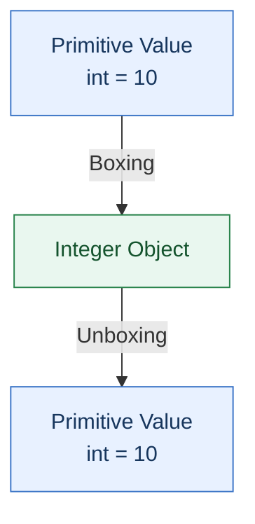

**Remember:**

- Boxing: Primitive → Wrapper Object
- Unboxing: Wrapper Object → Primitive

---

## 6. AutoBoxing and AutoUnboxing

Writing `Integer.valueOf()` and `intValue()` every time would become repetitive.

Java makes this easier by automatically performing these conversions.

### AutoBoxing

When Java automatically converts a primitive into its corresponding wrapper object, it is called AutoBoxing.

```java
int number = 10;

Integer wrappedNumber = number;
```

I didn't explicitly call `Integer.valueOf()`.

Java handles the conversion automatically.

Conceptually, this is equivalent to:

```java
Integer wrappedNumber = Integer.valueOf(number);
```

### AutoUnboxing

When Java automatically converts a wrapper object into its corresponding primitive value, it is called AutoUnboxing.

```java
Integer wrappedNumber = 20;

int number = wrappedNumber;
```

Conceptually, this is equivalent to:

```java
int number = wrappedNumber.intValue();
```

### Complete flow

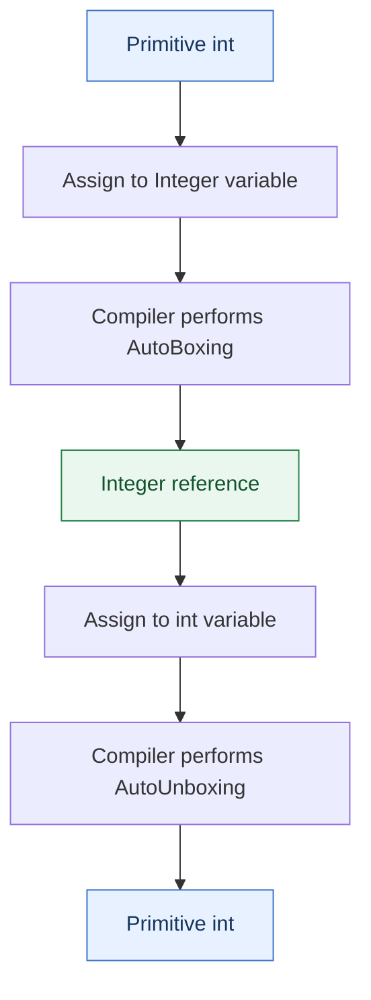

### What actually happens under the hood?

The Java compiler understands that the types are different.

When it sees:

```java
Integer number = 10;
```

It inserts the necessary boxing conversion.

When it sees:

```java
int value = number;
```

It inserts the necessary unboxing conversion.

The important point is that AutoBoxing and AutoUnboxing are language features handled by the compiler. They are not magic operations performed by the JVM on arbitrary assignments.

**My takeaway:** Boxing and Unboxing are the conversions. AutoBoxing and AutoUnboxing are Java's automatic way of performing those conversions.

---

## 7. Where Does Java Automatically Box and Unbox?

These conversions can happen in several places.

### A. Variable assignment

```java
int a = 10;

Integer b = a; // AutoBoxing

int c = b;     // AutoUnboxing
```

### B. Method arguments

```java
public class Main {

    static void display(Integer number) {
        System.out.println(number);
    }

    public static void main(String[] args) {

        int value = 50;

        display(value);
    }
}
```

The method expects an `Integer`, but I pass an `int`.

Java automatically boxes the value.

### C. Method return values

```java
public class Main {

    static Integer getNumber() {

        int number = 100;

        return number;
    }

    public static void main(String[] args) {

        Integer result = getNumber();

        System.out.println(result);
    }
}
```

The return expression is an `int`, but the method returns an `Integer`.

Java automatically boxes it.

### D. Arithmetic operations

```java
Integer a = 10;
Integer b = 20;

int result = a + b;

System.out.println(result);
```

Output:

```text
30
```

Java unboxes both Integer objects before performing primitive integer addition.

Conceptually:

```java
int result = a.intValue() + b.intValue();
```

**My takeaway:** Java can automatically box or unbox values during assignments, method calls, return statements, and operations where the conversion is required.

---

# PART 4 — Where Wrapper Classes Become Useful

## 8. AutoBoxing with Collections and Generics

Now I can finally understand why Wrapper Classes are so important when using Collections.

Consider:

```java
ArrayList<Integer> numbers = new ArrayList<>();

numbers.add(10);
numbers.add(20);
numbers.add(30);
```

The `add()` method expects an `Integer` object.

But I'm passing primitive `int` values.

Why does this work?

Because Java automatically boxes them.

Conceptually:

```java
numbers.add(Integer.valueOf(10));
numbers.add(Integer.valueOf(20));
numbers.add(Integer.valueOf(30));
```

### What happens when I retrieve a value?

```java
int number = numbers.get(0);
```

The `get()` method returns an `Integer`.

But I'm assigning it to an `int`.

Java automatically unboxes it.

### Complete execution flow

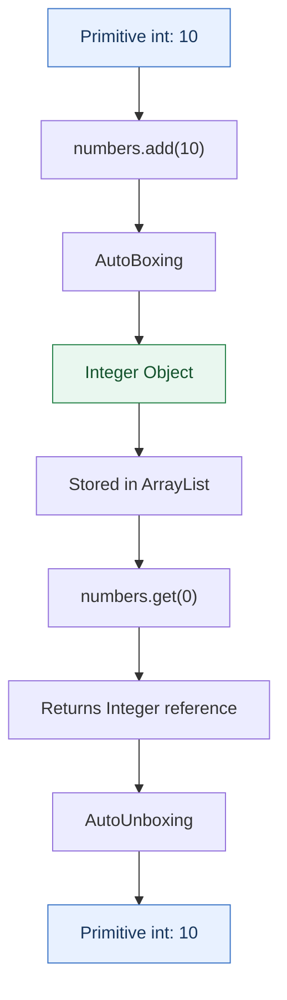

### Memory perspective

```text
                    STACK                         HEAP
          ┌──────────────────────┐
          │ numbers              │
          │ Reference ───────────┼─────────────┐
          └──────────────────────┘             │
                                               ▼
                                    ┌────────────────────┐
                                    │ ArrayList Object   │
                                    ├────────────────────┤
                                    │ Element 0 ─────────┼────┐
                                    │ Element 1 ─────────┼──┐ │
                                    │ Element 2 ─────────┼┐ │ │
                                    └────────────────────┘│ │ │
                                                         │ │ │
                                                         ▼ ▼ ▼
                                                    ┌───────────┐
                                                    │ Integer   │
                                                    │ value: 10 │
                                                    └───────────┘

                                                    ┌───────────┐
                                                    │ Integer   │
                                                    │ value: 20 │
                                                    └───────────┘

                                                    ┌───────────┐
                                                    │ Integer   │
                                                    │ value: 30 │
                                                    └───────────┘
```

This is a conceptual illustration. The actual internal representation of collection storage depends on its implementation.

### Why can't I use `ArrayList<int>`?

Because Java Generics require reference types as type arguments.

This is invalid:

```java
ArrayList<int> numbers = new ArrayList<>();
```

This is valid:

```java
ArrayList<Integer> numbers = new ArrayList<>();
```

**My takeaway:** Collections work with reference types. Wrapper Classes make primitive-like values usable with Generics, and AutoBoxing makes the syntax convenient.

---

# PART 5 — The Problems We Need to Watch Out For

Now that I understand how automatic conversion works, I need to understand its risks.

There are two particularly important areas:

1. `null` during unboxing.
2. Object comparison using `==` and `.equals()`.

## 9. NullPointerException During Unboxing

A reference variable can contain `null`.

A primitive variable cannot.

Consider:

```java
Integer number = null;

int value = number;

System.out.println(value);
```

This code compiles, but it throws a `NullPointerException` at runtime.

Why?

Because Java attempts to unbox the Integer reference.

Conceptually:

```java
int value = number.intValue();
```

But `number` is `null`.

Java cannot call `intValue()` on a null reference.

### Execution flow

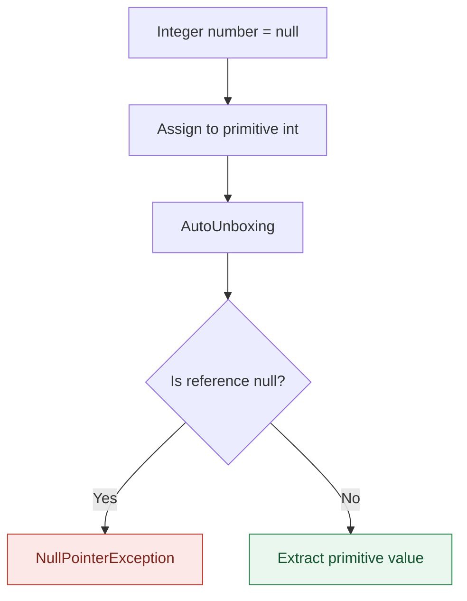

### How can I avoid it?

Check the reference before unboxing.

```java
Integer number = null;

int value = (number != null) ? number : 0;

System.out.println(value);
```

Output:

```text
0
```

**My takeaway:** A wrapper reference can be null, but unboxing null causes a NullPointerException. Check nullable wrappers before converting them into primitives.

---

## 10. `==` vs `.equals()`

Before understanding Integer Caching, I need to understand how Java compares objects.

Consider two primitive variables:

```java
int a = 100;
int b = 100;

System.out.println(a == b);
```

Output:

```text
true
```

For primitive values, `==` compares the actual values.

But what happens with objects?

```java
Integer a = Integer.valueOf(100);
Integer b = Integer.valueOf(100);

System.out.println(a == b);
System.out.println(a.equals(b));
```

The output may be:

```text
true
true
```

We'll understand why the first result is `true` when we reach Integer Caching.

For now, understand what each operator means.

### `==` with reference types

When used with objects, `==` checks whether both references point to the same object.

This is called **reference identity**.

### `.equals()` with objects

`.equals()` checks logical equality according to the class's implementation.

For `Integer`, `.equals()` compares the numerical values.

### Let's remove the confusion with two separate objects

```java
Integer a = Integer.valueOf(100);
Integer b = Integer.valueOf(1000);

System.out.println(a.equals(b));
```

The values are different, so the result is:

```text
false
```

But to understand identity properly, consider two references pointing to the same object:

```java
Integer a = Integer.valueOf(100);

Integer b = a;

System.out.println(a == b);
System.out.println(a.equals(b));
```

Output:

```text
true
true
```

Both references point to the same object, and both objects represent the same value.

### Memory perspective: Same object

```text
                 STACK                         HEAP
          ┌──────────────────┐
          │ a                │
          │ Reference ───────┼──────────────┐
          ├──────────────────┤              │
          │ b                │              │
          │ Reference ───────┼──────────┐   │
          └──────────────────┘          │   │
                                        ▼   ▼
                                   ┌─────────────┐
                                   │ Integer     │
                                   ├─────────────┤
                                   │ value: 100  │
                                   └─────────────┘

                               One object, two references.
```

### Quick comparison

| Expression | Meaning |
|---|---|
| `a == b` for primitives | Compares primitive values |
| `a == b` for references | Compares object identity |
| `a.equals(b)` | Uses the class's logical equality implementation |

One useful method is:

```java
Objects.equals(a, b);
```

It performs a null-safe equality check.

For example:

```java
Integer a = null;
Integer b = 100;

System.out.println(Objects.equals(a, b));
```

Output:

```text
false
```

**My takeaway:** `==` checks primitive values or reference identity. `.equals()` checks logical equality according to the class.

---

## 11. Understanding Integer Internally

Now I want to focus specifically on the `Integer` class.

`Integer` is the wrapper class for primitive `int`.

It is immutable and provides useful methods and constants.

```java
public class Main {

    public static void main(String[] args) {

        Integer number = 100;

        System.out.println(number.intValue());

        System.out.println(Integer.MAX_VALUE);

        System.out.println(Integer.MIN_VALUE);

        System.out.println(Integer.parseInt("500"));

        System.out.println(Integer.toString(200));
    }
}
```

Output:

```text
100
2147483647
-2147483648
500
200
```

### Useful Integer methods and fields

| Method / Field | Purpose |
|---|---|
| `intValue()` | Converts Integer into primitive int |
| `Integer.valueOf()` | Returns an Integer object |
| `Integer.parseInt()` | Converts a String into primitive int |
| `Integer.toString()` | Converts an int into a String |
| `Integer.MAX_VALUE` | Maximum int value |
| `Integer.MIN_VALUE` | Minimum int value |

### Integer is immutable

Consider:

```java
Integer number = 100;

number = number + 50;

System.out.println(number);
```

Output:

```text
150
```

Did Java modify the original Integer object?

No.

Conceptually, Java performs these steps:

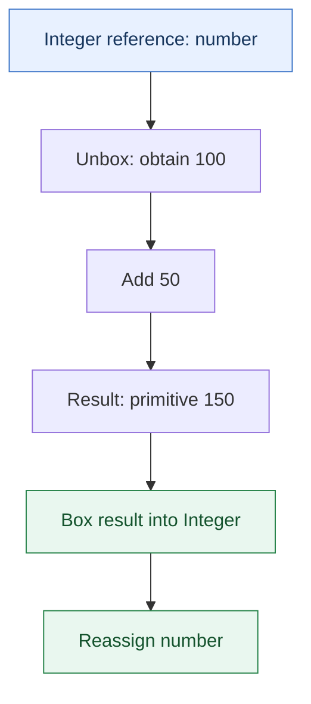

The original object is not modified. The variable is reassigned to the result.

---

## 12. Integer Caching

Now we can finally understand why this code can return `true`:

```java
Integer a = 100;
Integer b = 100;

System.out.println(a == b);
```

Output:

```text
true
```

Why?

Because Java uses **Integer Caching**.

### What is Integer Caching?

Java guarantees caching for Integer values from:

```text
-128 to 127
```

When a value in this range is obtained through `Integer.valueOf()` or the corresponding boxing conversion, Java can reuse a cached Integer object.

Consider:

```java
Integer a = Integer.valueOf(100);
Integer b = Integer.valueOf(100);
```

Both references can point to the same cached object.

### Memory perspective

```text
                 STACK                         HEAP
          ┌──────────────────┐
          │ a                │
          │ Reference ───────┼──────────────┐
          ├──────────────────┤              │
          │ b                │              │
          │ Reference ───────┼──────────┐   │
          └──────────────────┘          │   │
                                        ▼   ▼
                                   ┌──────────────┐
                                   │ Cached       │
                                   │ Integer      │
                                   ├──────────────┤
                                   │ value: 100   │
                                   └──────────────┘

                              One shared cached object.
```

Therefore:

```java
a == b       // true
a.equals(b)  // true
```

### What happens outside the guaranteed range?

Consider:

```java
Integer a = Integer.valueOf(1000);
Integer b = Integer.valueOf(1000);

System.out.println(a == b);
System.out.println(a.equals(b));
```

With the usual default cache, output is:

```text
false
true
```

The two calls typically return separate objects.

### Memory perspective

```text
                 STACK                         HEAP
          ┌──────────────────┐
          │ a                │
          │ Reference ───────┼───────────────┐
          ├──────────────────┤               │
          │ b                │               │
          │ Reference ───────┼───────────┐   │
          └──────────────────┘           │   │
                                         ▼   ▼
                                    ┌────────────┐
                                    │ Integer A  │
                                    ├────────────┤
                                    │ value:1000 │
                                    └────────────┘

                                    ┌────────────┐
                                    │ Integer B  │
                                    ├────────────┤
                                    │ value:1000 │
                                    └────────────┘

                             Two different objects.
```

The values are equal, but the references are different.

### Integer caching decision flow

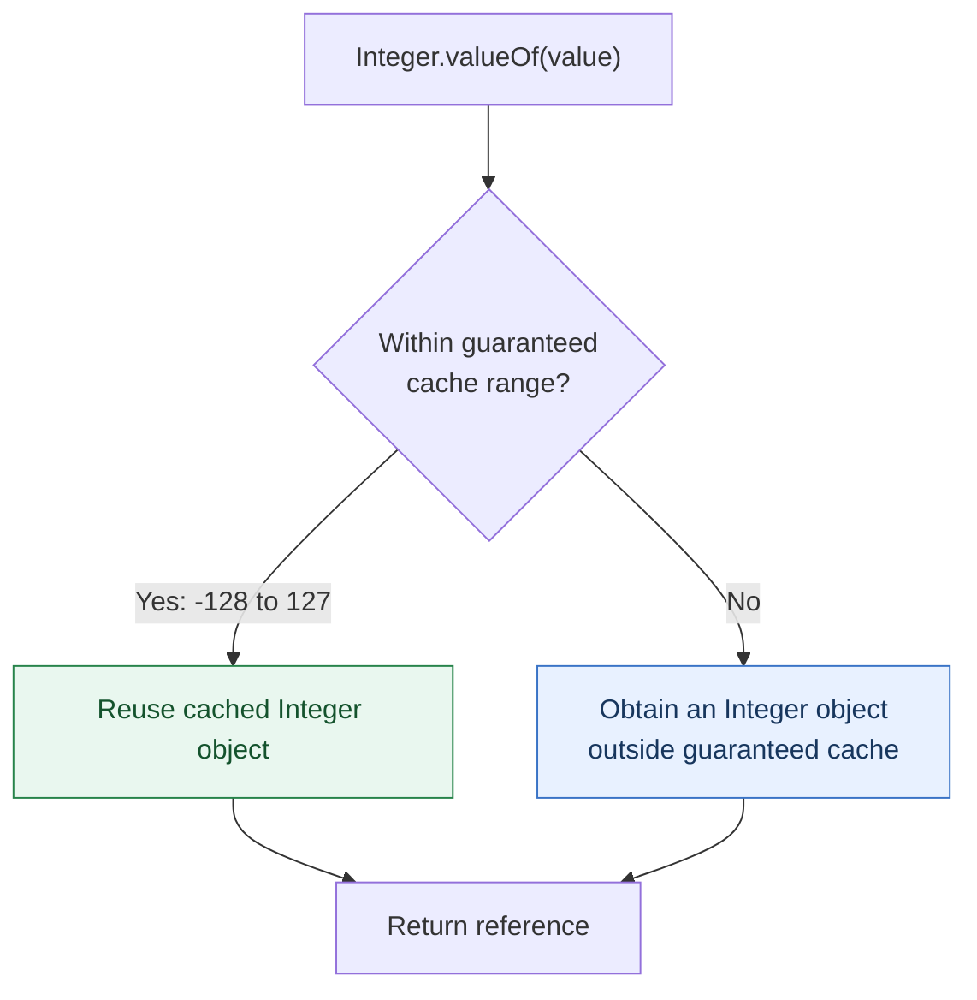

A JVM may cache additional values beyond the guaranteed range, so I should not depend on `==` for comparing Integer values.

### The correct habit

For comparing Integer values, use:

```java
a.equals(b);
```

If either reference may be null, use:

```java
Objects.equals(a, b);
```

**My takeaway:** Integer Caching is an optimization. It explains why two Integer references may point to the same object for certain values. It does not change the rule that `==` compares object identity.

---

# PART 6 — OOP Revision: Abstract Classes

## 13. Revising Abstract Classes

Now that the Wrapper Class concepts are clear, I want to revise Abstract Classes before moving towards POJOs.

I have already studied Abstraction and Abstract Classes, so this is a revision rather than a completely new topic.

### What is an Abstract Class?

An abstract class is a class declared using the `abstract` keyword.

It cannot be instantiated directly.

```java
abstract class Animal {

    abstract void sound();

    void eat() {
        System.out.println("Animal is eating");
    }
}
```

Here:

- `Animal` is an abstract class.
- `sound()` is an abstract method.
- `eat()` is a concrete method.

An abstract method has no method body.

A concrete method has a method body.

### Why use an Abstract Class?

Imagine I have different types of animals.

Every animal should have a `sound()` method, but each animal makes a different sound.

I can define common behaviour in the parent class and allow child classes to implement their own version.

```java
abstract class Animal {

    abstract void sound();

    void eat() {
        System.out.println("Eating...");
    }
}

class Dog extends Animal {

    @Override
    void sound() {
        System.out.println("Dog barks");
    }
}

class Cat extends Animal {

    @Override
    void sound() {
        System.out.println("Cat meows");
    }
}
```

Now:

```java
public class Main {

    public static void main(String[] args) {

        Animal animal = new Dog();

        animal.sound();
        animal.eat();
    }
}
```

Output:

```text
Dog barks
Eating...
```

### Can an Abstract Class have a constructor?

Yes.

Even though I cannot create an abstract class object directly, its constructor executes when a child object is created.

```java
abstract class Animal {

    Animal() {
        System.out.println("Animal constructor");
    }
}

class Dog extends Animal {

    Dog() {
        System.out.println("Dog constructor");
    }
}

public class Main {

    public static void main(String[] args) {

        Dog dog = new Dog();
    }
}
```

Output:

```text
Animal constructor
Dog constructor
```

### Constructor execution flow

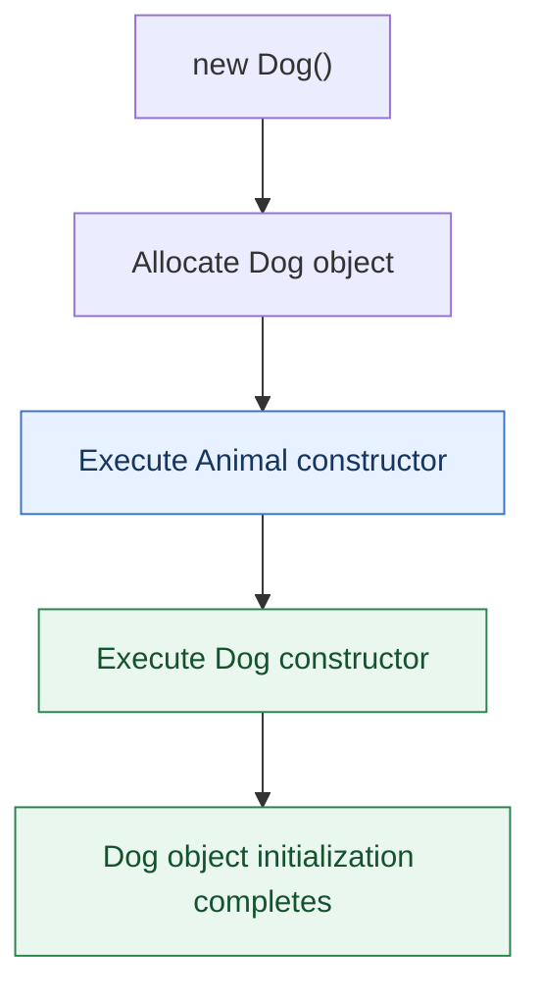

### Abstract Class vs Interface

| Abstract Class | Interface |
|---|---|
| Declared using `abstract class` | Declared using `interface` |
| Can have constructors | Cannot have constructors |
| Can have instance variables | Cannot have ordinary instance variables |
| Can have abstract and concrete methods | Can have abstract, default, static and private methods |
| Can maintain object state | Fields are implicitly `public static final` |
| A class can extend only one class | A class can implement multiple interfaces |
| Useful for related classes sharing state and implementation | Useful for defining capabilities and contracts |

### Can I use both together?

Yes.

```java
abstract class Vehicle {

    abstract void start();

    void stop() {
        System.out.println("Vehicle stopped");
    }
}

interface GPS {

    void navigate();
}

class Car extends Vehicle implements GPS {

    @Override
    void start() {
        System.out.println("Car started");
    }

    @Override
    public void navigate() {
        System.out.println("Navigation started");
    }
}
```

A class can extend an abstract class and implement multiple interfaces.

### Important rules to remember

1. An abstract class cannot be instantiated directly.
2. It can have constructors.
3. It can have instance variables.
4. It can have abstract and concrete methods.
5. A concrete child class must implement all inherited abstract methods.
6. An abstract class can extend another class.
7. An abstract class cannot be declared `final`.
8. An abstract class does not necessarily need an abstract method.
9. An abstract method cannot be `private`, `static`, or `final`.

### Interview questions

**Q1. Can an abstract class have a constructor?**

Yes. Its constructor executes when a child object is created.

**Q2. Can an abstract class contain no abstract methods?**

Yes. A class can be declared abstract even if all its methods are concrete.

**Q3. Can an abstract class extend another abstract class?**

Yes.

**Q4. What if a child class does not implement all inherited abstract methods?**

It must also be declared abstract. Otherwise, compilation fails.

**My takeaway:** Abstract Classes provide a shared base containing state and common implementation while allowing child classes to provide specific behaviour.

---

# PART 7 — Practical Java: POJO Classes

## 14. What Are POJO Classes?

POJO stands for **Plain Old Java Object**.

The idea is simple.

A POJO is an ordinary Java class that is not forced to extend a particular framework class or implement a framework-specific interface just to represent an object.

Consider:

```java
public class Student {

    private int id;
    private String name;
    private int age;

    public Student() {
    }

    public Student(int id, String name, int age) {
        this.id = id;
        this.name = name;
        this.age = age;
    }

    public int getId() {
        return id;
    }

    public void setId(int id) {
        this.id = id;
    }

    public String getName() {
        return name;
    }

    public void setName(String name) {
        this.name = name;
    }

    public int getAge() {
        return age;
    }

    public void setAge(int age) {
        this.age = age;
    }
}
```

This is a typical POJO.

It contains:

- Fields to represent data.
- Constructors to create objects.
- Getters and setters to access or update fields.
- No mandatory dependency on a particular framework.

A POJO does not strictly need getters and setters. It can also have methods, validation logic, and other behaviour.

The important idea is that it remains an ordinary Java object.

### Creating a POJO object

```java
public class Main {

    public static void main(String[] args) {

        Student student = new Student(
            101,
            "Vivek",
            20
        );

        System.out.println(student.getName());
    }
}
```

Output:

```text
Vivek
```

### Memory perspective

```text
                 STACK                         HEAP
        ┌─────────────────────┐
        │ student             │
        │ Reference ──────────┼───────────────┐
        └─────────────────────┘               │
                                              ▼
                                   ┌─────────────────────┐
                                   │ Student Object      │
                                   ├─────────────────────┤
                                   │ id   = 101          │
                                   │ name = "Vivek"      │
                                   │ age  = 20           │
                                   └─────────────────────┘
```

The `student` variable holds a reference to the object.

The object's fields represent its state.

**My takeaway:** A POJO is an ordinary Java object used to represent application data and, when needed, related behaviour.

---

## 15. Why Are POJOs Useful in Backend Frameworks?

This is where POJOs become especially important for backend development.

Imagine I am building a backend application.

It might deal with:

- Users
- Products
- Orders
- Payments
- Students
- Employees

I need Java classes to represent these things.

For example:

```java
public class User {

    private String name;
    private String email;
    private String password;
}
```

This class represents a User in my application.

Frameworks can work with these ordinary Java objects.

### How different frameworks use them

**1. Spring Framework**

Spring can create and manage ordinary Java objects as Spring beans.

These objects can be injected into other classes using Dependency Injection.

**2. Hibernate**

Hibernate can map Java classes and their fields to database tables.

For example, a User class can represent records in a `users` table when configured as an entity.

**3. Jackson**

Jackson can convert Java objects into JSON and JSON into Java objects.

For example, a Java User object can be serialized into:

```json
{
  "name": "Vivek",
  "email": "vivek@example.com"
}
```

The exact behaviour depends on the object's configuration, constructors, getters, fields, and serialization settings.

### How POJOs fit into a backend application

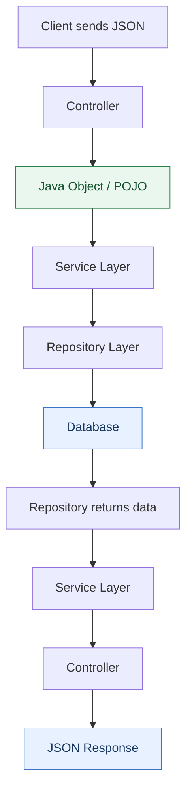

The POJO acts as a Java representation of data moving through the application.

It helps keep data representation separate from the framework's infrastructure and business logic.

### Why should I understand this?

When I work with frameworks such as Spring Boot, I will frequently see Java classes representing:

- Request bodies
- Response objects
- Database entities
- Configuration data
- Application models

These are often ordinary Java classes or POJOs.

**My takeaway:** POJOs help organize application data and are widely used by backend frameworks.

---

# PART 8 — Understanding Java Source Files

## 16. Why Does Java Allow Only One Public Top-Level Type Per File?

This is the last topic of the lesson, but it connects to something important about how Java source code is organized and compiled.

I don't want to remember this as just a rule.

I want to understand:

1. What is a source file?
2. What is a top-level class?
3. Why does a public class need a matching filename?
4. What happens when `javac` compiles the file?
5. What happens when the JVM loads the compiled classes?

### First, understand what a top-level class is

Consider:

```java
public class Main {

    public static void main(String[] args) {
        Student student = new Student();
    }
}

class Student {
}
```

There are two classes here:

- `Main`
- `Student`

Both are top-level classes because neither is declared inside another class.

Now look at this:

```java
public class Main {

    class Student {
    }
}
```

Here, `Student` is declared inside `Main`.

It is a nested class, not a top-level class.

This distinction matters because the source-file naming rule applies to public top-level types.

---

### 16.1 Can one Java file contain multiple classes?

Yes.

Consider a file named `Main.java`:

```java
public class Main {
}

class Student {
}

class Teacher {
}
```

This is valid.

Why?

Because Java allows multiple top-level types in a source file, provided the public top-level type restriction is followed.

When I compile:

```bash
javac Main.java
```

The compiler can produce:

```text
Project/
│
├── Main.java
│
├── Main.class
├── Student.class
└── Teacher.class
```

One source file can produce multiple `.class` files.

### Under the hood: Compilation

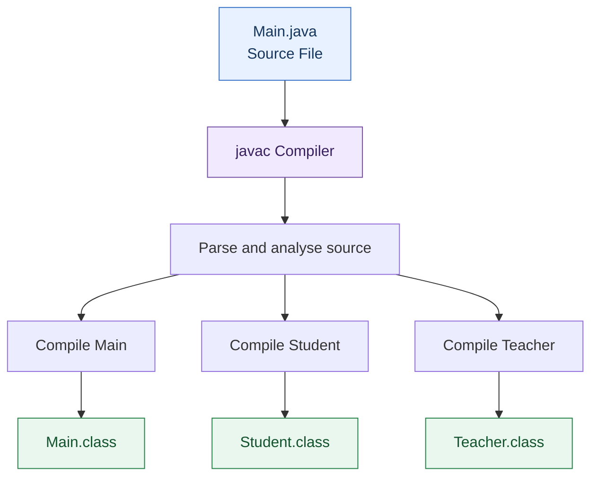

Notice:

The `.java` file is the source compilation unit.

The `.class` files are the compiled representations of individual classes.

They are not the same thing.

---

### 16.2 Why must a public class name match the filename?

Now suppose I write:

```java
public class Student {
}
```

What should the filename be?

```text
Student.java
```

Not:

```text
Main.java
```

If I save the public class `Student` inside `Main.java` in the normal file-based Java compilation setup, the compiler reports an error similar to:

```text
class Student is public, should be declared in a file named Student.java
```

### But why does Java enforce this?

Think about a project containing hundreds of classes.

```text
src/
│
├── Main.java
├── Student.java
├── Teacher.java
├── Employee.java
├── Vehicle.java
└── BankAccount.java
```

Suppose another source file uses `Student`.

```java
public class Main {

    public static void main(String[] args) {

        Student student = new Student();
    }
}
```

The compiler or Java development tools need to locate the definition of `Student`.

A predictable convention makes this easier:

```text
Student → Student.java
```

The public type name and filename have a clear relationship.

This makes source discovery, compilation, navigation, and project organization predictable.

**Important:** This is a source-file naming convention enforced by Java's compilation rules. It is not the JVM's class-loading mechanism. The JVM loads compiled classes using their binary names and class loaders, not by searching for their `.java` filenames.

### Visualise the relationship

```text
          PUBLIC TOP-LEVEL TYPE
                  │
                  ▼
             Student
                  │
                  │ Must match
                  ▼
             Student.java
                  │
                  │ Compiled by javac
                  ▼
             Student.class
```

---

### 16.3 Why only one public top-level type?

Now consider:

```java
public class Main {
}

public class Student {
}
```

Both are public top-level classes in the same source file.

In the normal file-based Java compilation setup, this is invalid.

Why?

Because each public top-level type has its own required source filename.

```text
public class Main     → Main.java
public class Student  → Student.java
```

But both are being placed inside:

```text
Main.java
```

That conflicts with the public top-level type naming rule.

The correct structure is:

```text
Project/
│
├── Main.java
│
└── Student.java
```

**Main.java**

```java
public class Main {

    public static void main(String[] args) {

        Student student = new Student();
        student.display();
    }
}
```

**Student.java**

```java
public class Student {

    public void display() {
        System.out.println("Hello Vivek");
    }
}
```

Now each public class has its own correctly named source file.

### Why can non-public classes share a file?

Consider:

```java
public class Main {
}

class Student {
}

class Teacher {
}

class Employee {
}
```

This is valid.

`Student`, `Teacher`, and `Employee` are package-private.

They don't individually need to match the filename.

The compiler can generate:

```text
Main.class
Student.class
Teacher.class
Employee.class
```

### Comparison

| Declaration | Allowed together in one source file? |
|---|---|
| One public top-level class + package-private classes | Yes |
| Multiple package-private top-level classes | Yes |
| Two public top-level classes | No, in normal file-based compilation |
| One public top-level class + public nested classes | Yes |

A package-private class is accessible to other classes in the same package, not just to classes in the same source file.

---

### 16.4 What happens when the JVM runs these classes?

Consider:

**Main.java**

```java
public class Main {

    public static void main(String[] args) {

        Student student = new Student();

        student.display();
    }
}

class Student {

    void display() {
        System.out.println("Hello Vivek");
    }
}
```

First compile:

```bash
javac Main.java
```

Then run:

```bash
java Main
```

The process is roughly:

1. The JVM starts with `Main` as the requested entry class.
2. The class loader loads `Main.class`.
3. The JVM verifies and prepares the class.
4. The JVM initializes the class when required.
5. The JVM invokes `main()`.
6. Execution reaches `new Student()`.
7. The JVM makes the `Student` class available through the class-loading mechanism if it has not already been loaded.
8. The Student object is created.
9. Its constructor executes.
10. `display()` is called.

### Execution flow

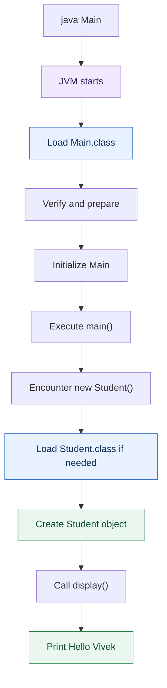

The JVM doesn't care whether `Main` and `Student` originally came from the same `.java` file.

After compilation, it works with their compiled class representations.

---

### 16.5 What about nested classes?

Consider:

```java
public class Main {

    public class Student {
    }

    public class Teacher {
    }
}
```

This is valid.

Why?

Because `Student` and `Teacher` are nested classes.

They are not separate top-level types.

I can have multiple public nested classes inside a public top-level class.

The same source-file rule also applies to public top-level interfaces, enums, and records, not just classes.

### Final mental picture

```text
                   Main.java
                       │
                       ▼
              ┌───────────────────┐
              │ Compilation Unit │
              ├───────────────────┤
              │ public Main       │
              │ class Student     │
              │ class Teacher     │
              └───────────────────┘
                       │
                       ▼
                  javac compiler
                       │
             ┌─────────┼─────────┐
             ▼         ▼         ▼
          Main.class Student.class Teacher.class
             │         │         │
             └─────────┼─────────┘
                       ▼
                      JVM
```

**My takeaway:**

- A Java source file can contain multiple top-level types.
- In normal file-based compilation, at most one top-level type can be public.
- The public top-level type's name must match the source filename.
- Package-private top-level types can share the same file.
- Nested classes don't count as separate top-level types.
- One `.java` file can generate multiple `.class` files.
- The JVM loads compiled classes, not Java source files.

---

# PART 9 — Final Mental Model

## 17. Connecting Everything I Learned

Now the entire lesson should make sense as one connected progression.

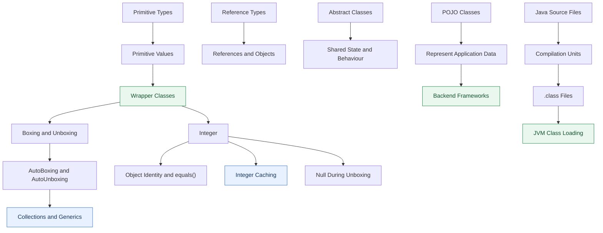

### What I should remember

| Concept | Main idea |
|---|---|
| Primitive Types | Variables hold primitive values |
| Reference Types | Variables hold references to objects |
| Wrapper Classes | Represent primitive values as objects |
| Boxing | Primitive to wrapper object |
| Unboxing | Wrapper object to primitive |
| AutoBoxing | Automatic boxing |
| AutoUnboxing | Automatic unboxing |
| Generics | Require reference types as type arguments |
| Null Unboxing | Can cause `NullPointerException` |
| `==` | Compares primitive values or reference identity |
| `.equals()` | Checks logical equality based on class implementation |
| Integer Caching | Reuses certain Integer objects |
| Abstract Class | Provides shared state and implementation |
| POJO | Ordinary Java object used to represent data |
| Java Source File | Contains a compilation unit |
| `.class` File | Contains compiled class representation |

---

# PART 10 — Test My Understanding

Reading the lesson is not enough. I should be able to explain the concepts without looking at the README.

## A. Conceptual Questions

1. What is the difference between primitive and reference types?
2. What happens when one reference variable is assigned to another?
3. Why do Wrapper Classes exist?
4. Why can't we use primitive types directly with Java Generics?
5. What is the difference between Boxing and Unboxing?
6. What is the difference between AutoBoxing and AutoUnboxing?
7. At which places can Java perform automatic boxing and unboxing?
8. Why does unboxing a null Integer cause a `NullPointerException`?
9. What is the difference between `==` and `.equals()`?
10. What is Integer Caching?
11. Why can two Integer references containing `100` point to the same object?
12. Are Integer objects mutable?
13. Can an Abstract Class have a constructor?
14. Can an Abstract Class have no abstract methods?
15. What is a POJO?
16. How do backend frameworks use POJOs?
17. What is a top-level class?
18. Why must a public top-level type match its filename?
19. Can one Java source file produce multiple `.class` files?
20. Does the JVM load `.java` files at runtime?

## B. Code-Based Questions

### Question 1 — Primitive assignment

```java
int a = 10;
int b = a;

b = 50;

System.out.println(a);
System.out.println(b);
```

What is the output, and why?

### Question 2 — Reference assignment

```java
class Student {
    String name;
}

public class Main {

    public static void main(String[] args) {

        Student s1 = new Student();
        s1.name = "Vivek";

        Student s2 = s1;

        s2.name = "Rahul";

        System.out.println(s1.name);
    }
}
```

Why does the output show `Rahul`?

### Question 3 — AutoBoxing

```java
int number = 100;

Integer value = number;

System.out.println(value);
```

What conversion happens here?

### Question 4 — AutoUnboxing

```java
Integer number = 200;

int value = number;

System.out.println(value);
```

What conversion happens here?

### Question 5 — NullPointerException

```java
Integer number = null;

int value = number;
```

Why does this compile but fail at runtime?

### Question 6 — Integer Caching

```java
Integer a = 100;
Integer b = 100;

System.out.println(a == b);
System.out.println(a.equals(b));
```

What are the results, and why?

### Question 7 — Outside the guaranteed cache range

```java
Integer a = 1000;
Integer b = 1000;

System.out.println(a == b);
System.out.println(a.equals(b));
```

Assuming the usual default Integer cache, what are the results?

### Question 8 — Abstract Classes

Can I create an object of an abstract class directly? Can I create a reference of its type?

Explain with an example.

### Question 9 — POJO

Create a `Student` POJO with:

- `id`
- `name`
- `age`

Add a constructor, getters, and setters.

### Question 10 — Java File Structure

Suppose `Main.java` contains:

```java
public class Main {
}

class Student {
}

class Teacher {
}
```

How many `.class` files can be generated?

Can I make `Student` public without changing the file structure?

Explain why.

---

## Final note to myself

The most important thing in this lesson is understanding how Java handles values, references, and objects.

I should be able to explain:

- Why primitive and reference variables behave differently.
- Why Wrapper Classes are necessary.
- How Java performs automatic conversions.
- What happens internally during unboxing.
- Why `==` and `.equals()` are different.
- How Integer Caching works.
- How Abstract Classes provide shared behaviour.
- Why POJOs are useful in backend development.
- How Java source files become compiled class files.

If I can explain these concepts with their memory diagrams and execution flows, I haven't just memorised Java syntax. I've understood what is happening behind the code.